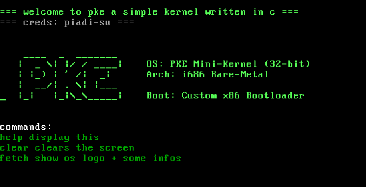

# pke

pke is just a really simple 32 bit kernel written in c 
that just print to the screen trough the vga buffer

### demo



### requirements

```
- qemu
- clang
- nasm
```

need to add:

- [] simple keyboard support
- [] simple shell
